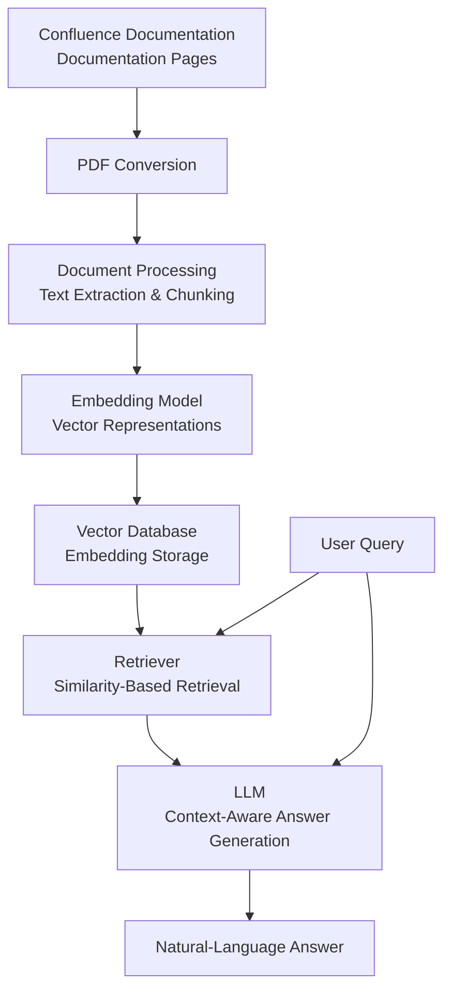

# RAG Confluence Knowledge Assistant

## NOTE: This is an independently created technical blueprint based on concepts and learnings from a professional project developed during my employment. It is intended for technical reference and demonstration purposes and does not contain any proprietary source code or confidential information.

## 1. Background

Enterprise documentation platforms contain large amounts of information spread across multiple pages and spaces. Finding specific information often requires users to manually search through documents and identify relevant content.

This project introduces a Retrieval-Augmented Generation (RAG) proof of concept that enables users to ask natural-language questions about Confluence documentation and receive answers grounded in retrieved document content.

## 2. Problem Statement

Traditional documentation search relies heavily on keyword matching and manual navigation. Users must locate relevant pages, read through lengthy content, and connect information across documents to answer specific questions.

A natural-language assistant can simplify this process, but generating reliable answers requires retrieving relevant documentation and providing sufficient context to the language model.

## 3. Existing Limitations

- **Manual Information Discovery:** Users must search and navigate multiple documentation pages.
- **Fragmented Knowledge:** Relevant information may be distributed across several documents.
- **Context Limitations:** Large documents cannot always be supplied directly to an LLM.
- **Retrieval Challenges:** Poor chunking or retrieval strategies can return incomplete or irrelevant context.
- **Hallucination Risk:** LLMs may generate unsupported or incorrect answers even when documentation is available.

## 4. Proposed System

A RAG-based documentation assistant that converts Confluence pages into PDF documents, generates vector embeddings from their content, and stores them in a vector database.

When a user submits a natural-language question, the system retrieves relevant document context and supplies it to an LLM to generate a context-aware answer.

The POC also explores different chunk sizes and retrieval approaches to understand how document segmentation and context selection influence answer relevance and accuracy.

## 5. Key Capabilities

- **Documentation Ingestion:** Converts Confluence documentation pages into PDF documents for processing.
- **Text Processing:** Extracts document content and prepares it for embedding generation.
- **Embedding Generation:** Converts document content into vector representations.
- **Vector Storage:** Stores embeddings in a vector database for semantic retrieval.
- **Semantic Search:** Retrieves document context relevant to natural-language questions.
- **Context-Aware Answer Generation:** Supplies retrieved content to an LLM to generate answers.
- **Retrieval Experimentation:** Evaluates different chunk sizes and retrieval approaches to improve context relevance.

## 6. Architecture

The solution consists of the following components:

## 7. Evaluation

The POC was evaluated through experimentation with document chunking, retrieval relevance, and the quality of LLM-generated answers.

| Evaluation Metric               | How It Applies to the POC                                                                               | Observed Results                                                                                                                                            |
| ------------------------------- | ------------------------------------------------------------------------------------------------------- | ----------------------------------------------------------------------------------------------------------------------------------------------------------- |
| **Retrieval Precision@K**       | Measures how many of the top K retrieved document chunks are relevant to the user's question.           | Retrieved context varied depending on chunk size and retrieval strategy; some configurations provided more relevant context than others.                    |
| **Retrieval Recall@K**          | Measures whether the retrieval process captures the relevant documentation needed to answer a question. | Experiments highlighted that relevant information could be missed when document segmentation or retrieval did not preserve sufficient context.              |
| **Answer Accuracy**             | Evaluates whether generated answers correctly reflect the source documentation.                         | Initial results were not consistently accurate; some answers contained incorrect or unsupported information.                                                |
| **Faithfulness / Groundedness** | Measures whether generated answers are supported by the retrieved document context.                     | Observed hallucinations demonstrated that supplying retrieved context alone does not guarantee that answers remain grounded in documentation.               |
| **Chunk Size Sensitivity**      | Examines how different chunk sizes affect context relevance and answer quality.                         | Different chunk sizes produced variations in retrieval relevance, highlighting the trade-off between preserving context and retrieving focused information. |
| **Documentation Search Time**   | Compares the effort required to find information manually against using natural-language queries.       | Demonstrated the potential to simplify documentation discovery, although a controlled time-saving comparison was not performed.                             |

The experiments highlighted that RAG answer quality depends on more than embedding generation and vector search. Document segmentation, retrieval relevance, context completeness, and the LLM's ability to remain grounded all influence the final response.

## 8. Results and Impact

- **Natural-Language Documentation Access:** Demonstrated how users can query documentation without manually navigating multiple pages.
- **End-to-End RAG Implementation:** Established a complete workflow from PDF ingestion and embedding generation to vector retrieval and LLM-based answer generation.
- **Retrieval Optimization Insights:** Explored how chunk sizes and retrieval approaches influence the relevance of retrieved context.
- **Hallucination Analysis:** Identified that retrieved context does not automatically guarantee accurate or grounded answers.
- **Foundation for Evaluation:** Established opportunities to measure retrieval precision, recall, answer accuracy, faithfulness, and documentation search time.

## 9. Future Enhancements

- **Improved Document Parsing:** Preserve document structure, headings, tables, and metadata during ingestion.
- **Advanced Chunking Strategies:** Explore recursive, semantic, and structure-aware chunking.
- **Hybrid Retrieval:** Combine vector similarity with keyword-based search.
- **Reranking:** Introduce a reranking model to improve the relevance of retrieved chunks.
- **Grounded Answer Generation:** Strengthen prompts to require source-supported answers and abstain when sufficient context is unavailable.
- **Source Citations:** Include document references and relevant excerpts in generated answers.
- **Systematic Evaluation:** Build a benchmark dataset to measure retrieval precision, recall, answer accuracy, and faithfulness.

## 10. Conclusion

The Confluence Knowledge Assistant demonstrates an end-to-end Retrieval-Augmented Generation workflow for natural-language documentation search.

Beyond implementing document ingestion, embedding generation, vector storage, retrieval, and answer generation, the POC provided practical insights into the challenges of building reliable RAG systems.

Experimentation with chunk sizes and retrieval approaches, along with the observation of hallucinations and inaccurate answers, highlighted why retrieval quality and answer grounding are critical to delivering trustworthy documentation assistants.
